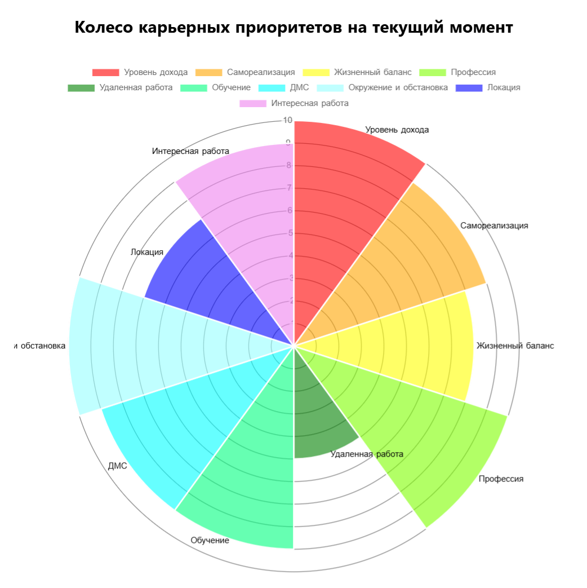
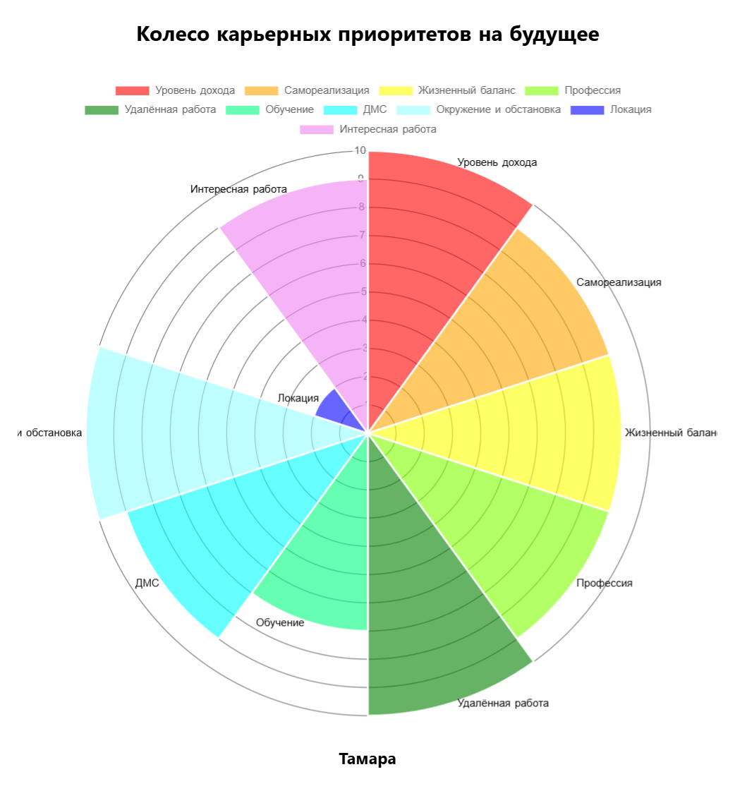

# 1. Выпиши критерии выбора работы и оцени по шкале от 1 до 10, что происходит на данный момент (от 5 и более).

# 2. Сделай второе колесо с теми же критериями и оцени их снова от 1 до 10, как бы тебе хотелось, чтобы эти критерии выглядели в будущем.

# 3. Для каждого критерия придумай и впиши шаги действия, которые ты будешь делать, чтобы его достичь.

## Уровень дохода. 
Для достижения уровня дохода при работе на себя или параллельно с основной работой:

1. Определиться с тем, какой уровень дохода необходим на данный момент.
2. Развивать навыки, которые необходимы для выбранной сферы деятельности.
3. Нарабатывать аудиторию.
4. Нарабатывать личный бренд, который будет способствовать достижению желаемого уровня дохода.
5. Постоянно работать над собой, своим продвижением и развитием навыков.
6. Повышать свой уровень энергии через здоровый сон, правильное питание и другие аспекты здорового образа жизни.

## Самореализация

Для достижения самореализации:

1. При работе в найме:
   - Искать работу, где есть возможность карьерного роста
   - Проявлять свои навыки и зарекомендовать себя как специалиста.
   - Наладить отношения с коллегами.
   

2. При реализации себя в качестве личного бренда и бизнеса:
   - Работать над своими навыками 
   - Развидеть свою аудиторию
   - Работать над личным брендом.
   - Работать над своей проявленностью.

## Жизненный баланс

Для достижения жизненного баланса:

1. Натренировать дисциплину, так как именно она предопределяет баланс в жизни.
2. Выстроить свою работу настолько эффективно, чтобы не спать на работе, то есть тратить время с пользой.
3. Понять, сколько времени необходимо на личную жизнь, здоровье и работу.
4. Установить личные границы, где есть трудовая гигиена и недопущение со стороны коллег нарушать временной график. Возможно, научить коллег и себя соблюдать как свой, так и чужой временной график.

## Профессия

Для достижения цели в профессии:

1. Определиться с направлением — бизнес и системная аналитика.
2. Рассмотреть возможность внедрения в свою работу инструменты продукт-менеджмента.
3. Внедрить маркетинговые инструменты в свою работу.
4. Освоить разработку как профессию для лучшего общения с разработчиками.
5. Использовать продукт-менеджмент и маркетинг не только для работы в найме, но и для продвижения частных проектов, в том числе своих.
6. Найти вакансию, где есть возможности для продвижения как рабочих, так и личных проектов.

## Удалённая работа

Для достижения цели в удалённой работе:

1. Рассмотреть возможность гибкого графика, как в офисе, так и удалённо.
2. В первой вакансии быть готовой к работе строго в офисе.
3. В последующих вакансиях отдавать предпочтение удалённой работе для большей свободы и отсутствия привязки к месту.
4. В идеале, если удалённая работа позволяет работать на себя.
5. Учитывать возможность перехода на гибкий график в будущем, особенно если появится семья.

## Обучение

Для достижения цели в обучении:

1. Найти компанию, которая предоставляет обучение по договорённости или через стороннюю платформу (при работе в найме).
2. Определиться с направлением, в котором необходимо обучаться (как при работе в найме, так и для личного бренда).
3. Пройти обучение.
4. Применять полученные навыки.

## ДМС

Для достижения цели в выборе ДМС:

1. При работе в найме выбрать компанию, которая предоставляет ДМС.
2. Если работать на себя, предусмотреть ДМС для сотрудников и для себя.
3. Ориентироваться на список клиник, которые есть в данной страховке.
4. Учитывать направления, которые необходимы для лечения.
5. Убедиться, что в ДМС включен психолог с возможностью покрытия как минимум трёх сеансов.
6. Иметь возможность платить за ДМС и покупать его.

## Окружение и обстановка

Для достижения цели в окружении и обстановке:

1. При собеседовании в команду пообщаться с руководителем и оценить его поведение, критерии и оценку.
2. Если устроиться на работу к этому человеку, оценить команду, их поведение, возможности и то, как они выстраивают обстановку вокруг себя.
3. Грамотно взаимодействовать с командой, исходя из оценки.
4. Найти пути грамотного налаживания контакта с окружением и выстраивания приятной обстановки вокруг себя в коллективе.
5. Поддерживать прекрасные отношения с коллективом в целом.
6. При выстраивании личных проектов и найме на работу самостоятельно выстраивать обстановку, диктовать её, подбирать персонал на первых этапах и следить за поведением каждого человека.

## Интересная работа

Для достижения цели в интересной работе:

1. Искать работу, связанную с креативом, интересными задачами, продукт-менеджментом и, возможно, маркетингом.
2. Найти вакансию, которая соответствует этим критериям.
3. Учитывать, что работа должна включать не только аналитические задачи (SQL, Python), но и креативную составляющую, связанную с продукт-менеджментом, маркетингом и общением с разработчиками.
4. Создавать интересные продукты и что-то новое.
5. Анализировать актуальность и использовать маркетинговые инструменты и выстраивание требований.

## Локация

Для достижения цели в выборе локации:

1. При гибридном графике или строго офисной работе:
    - Учитывать близость к дому.
    - Рассматривать расположение в центре или не в центре.
2. При полностью удалённой работе или работе на себя:
    - Локация не важна, важна обстановка и место, где работаешь удалённо.
    - Удалённый график даёт возможность быть там, где хочется, в удобное время.
